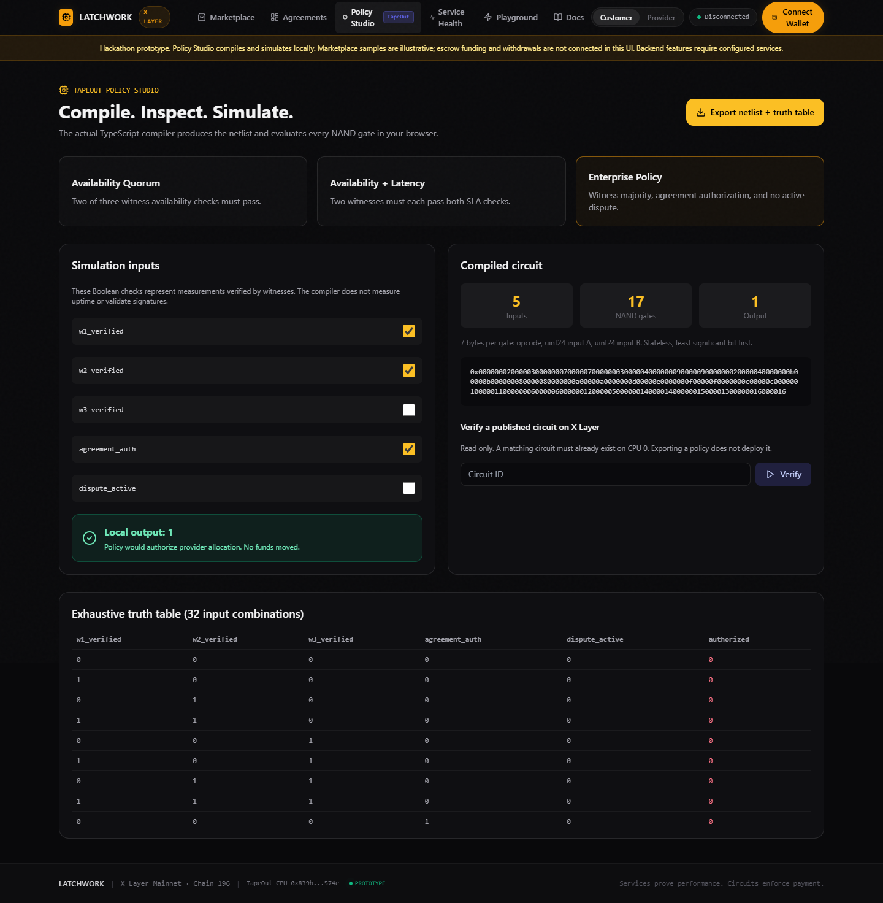

# LATCHWORK

**Services prove performance. Circuits enforce payment.**

Programmable API service agreements using signed performance observations and TapeOut NAND circuits on X Layer.

[Web preview](https://eshaanvgupta.github.io/latchwork/) | [Source](https://github.com/eshaanvgupta/latchwork) | [Engineering review](docs/ENGINEERING_REVIEW.md) | [Hackathon draft](docs/hackathon/SUBMISSION.md)

## Current status

This is a hackathon prototype under active review. The public GitHub Pages deployment hosts the frontend and local Policy Studio. Backend-dependent screens need separately running API, gateway and monitoring services. Sample data is labeled, and failed network operations do not produce fabricated receipts or transaction hashes.

The adapter has passed read-only tests against an existing TapeOut circuit on X Layer mainnet. LATCHWORK contracts and its SLA circuit have **not** been verified as deployed on X Layer. Local Solidity tests use a mock processor. No end-to-end mainnet escrow/payment/withdrawal claim is made. Do not use this prototype to custody meaningful funds.

## What is in the repository

| Directory | Implementation |
| --- | --- |
| `apps/web` | Next.js UI, wallet connection, marketplace, agreements, local circuit compiler and simulator |
| `apps/api` | Fastify API, wallet challenge authentication, organizations, service and agreement records, transaction preparation |
| `apps/gateway` | Credential-bound HTTP forwarding, URL checks, rate limiting, signed request receipts |
| `apps/monitor` | Three operator-controlled signing identities, HTTP probing, report signing, local chaos test service |
| `packages/contracts` | Solidity escrow, agreement, policy, witness, dispute and treasury contracts, deployment script and tests |
| `packages/circuit-compiler` | Boolean primitives, NAND netlists, simulation and truth tables |
| `packages/tapeout-adapter` | TapeOut reads, circuit submission support and equivalence verification |
| `packages/database` | Prisma SQLite schema and seed data |
| `packages/sdk`, `packages/shared` | TypeScript integration helpers and protocol types |

SQLite is the implemented database. PostgreSQL, Redis queues, durable blockchain indexing and production billing are not implemented by the current stack.

## Local setup

Use Node.js >=22.13, pnpm 11.25.0 and Git. Solidity checks additionally require Foundry. On Windows, use `pnpm.cmd` when PowerShell blocks `pnpm.ps1`.

```bash
git clone --recurse-submodules https://github.com/eshaanvgupta/latchwork.git
cd latchwork
cp .env.example .env
pnpm install --frozen-lockfile
pnpm build:packages
pnpm db:setup
pnpm dev:all
```

On PowerShell, use `Copy-Item .env.example .env` for the copy step. The example configuration enables loopback upstreams only for a local sandbox; production rejects that exception. Development signing keys in source are public test identities. Never fund or register those identities in a deployed financial system.

| Service | Local URL |
| --- | --- |
| Web | http://localhost:3000 |
| API | http://localhost:4000/health |
| Gateway | http://localhost:4001/health |
| Chaos test service | http://localhost:4002/health |
| Monitor | http://localhost:4003/health |

Optional local container configuration: `docker compose up --build`. It shares a persistent SQLite volume and binds published ports to loopback. Docker execution was unavailable during this review, so the container path remains unverified.

## Verification

```bash
pnpm build:packages
pnpm test
pnpm --filter './apps/*' build
pnpm test:contracts
pnpm test:integration
pnpm demo
```

`pnpm test` includes live, read-only TapeOut adapter tests and therefore needs network access. `pnpm demo` is a read-only TapeOut equivalence check; it does not broadcast a transaction or move funds. Use a fresh test database before API tests, as demonstrated in [CI](.github/workflows/ci.yml).

`pnpm test:integration` starts temporary loopback HTTP services and an isolated SQLite database. It checks wallet login, service registration, gateway forwarding, receipt signatures, three measured witness reports and persistence after process restart. It uses explicitly unfunded sandbox agreements and never broadcasts a blockchain transaction.



## TapeOut evidence

| Item | Checked configuration |
| --- | --- |
| Network | X Layer mainnet, chain ID 196 |
| Processor | `0x839bdD6fa7A66416A609A735e11DE5411B98574e` |
| Factory | `0x1f09daefa827f02cbb40967cc91b259763760761` |
| Existing circuit used for reads | Circuit 1, stateless two-input XOR, four NAND gates |
| Gate encoding | 7 bytes: opcode, big-endian uint24 input A, big-endian uint24 input B |

This XOR circuit belongs to the existing ecosystem. It is not a deployed LATCHWORK SLA circuit. Full settlement deployment still requires a registered compatible SLA circuit and deployed LATCHWORK contracts, followed by transaction-backed verification.

## Deployment and submission

The [Pages workflow](.github/workflows/pages.yml) builds a static frontend with `/latchwork` as its base path. GitHub Pages cannot run the backend, database or monitoring processes. A future hosted backend needs HTTPS URLs configured at frontend build time, persistent storage, private signing identities and access controls.

The [official hackathon page](https://web3.okx.com/xlayer/build-x-series) requires meaningful TapeOut usage on X Layer, relevant addresses, an access link and commercial context. The currently listed provisional deadline is December 7, 2026 at 23:59 UTC (December 8 at 05:29 IST). See the [submission draft](docs/hackathon/SUBMISSION.md) for the remaining eligibility evidence and the [video script](docs/hackathon/VIDEO_SCRIPT.md) for a demonstration that matches the implemented behavior.

This repository publication is not a hackathon form submission. See [security and trust assumptions](docs/security/SECURITY_THREAT_MODEL.md) before deploying contracts or exposing services.
