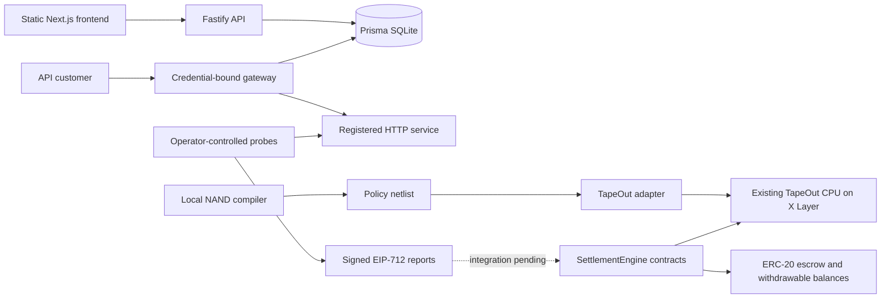

# LATCHWORK architecture

The prototype separates web presentation, API records, gateway receipts, witness observations and Solidity settlement logic.

Solid edges show implemented component relationships; the API-to-chain/indexer path is not a verified deployed product flow. The public Pages site runs only the static UI and local compiler.

## Data and trust boundaries

- Wallet challenge signatures authenticate API sessions. Gateway credentials are hashed in SQLite and tied to one agreement/service.
- Gateway receipts sign request/response hashes and timing data. They attest to gateway observations, not provider acknowledgments or payload correctness.
- Three witness identities run under one operator in the current monitor. Separate keys do not make their observations independent.
- Solidity verifies typed reports and calls a configured TapeOut processor for policy output. Local settlement tests use `MockTapeOutProcessor`.
- There is no implemented production PostgreSQL migration, distributed Redis limiter, durable event indexer or subscription billing engine.

## Netlist format

Each NAND gate encodes `[uint8 opcode=0, uint24 inA, uint24 inB]` in big-endian order. Wire 0 is false, wire 1 is true, inputs begin at wire 2 and gate outputs follow inputs. Circuit input/output bits are packed least-significant-bit first. Initial settlement policies reject latches and use the supported stateless input layouts; see the contracts for enforced constraints.
